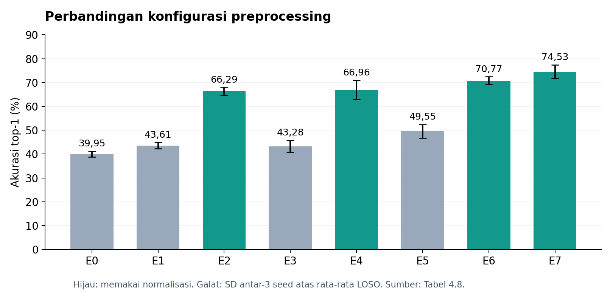
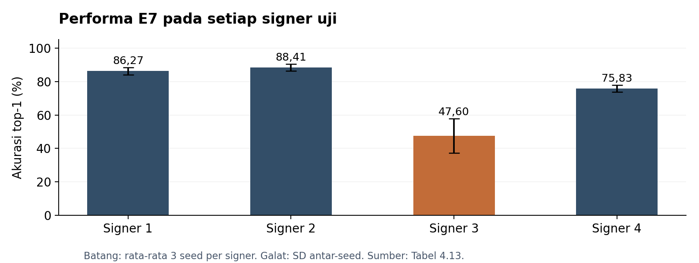

# Pengaruh Preprocessing Pose terhadap Generalisasi ResGCN pada WL-BISINDO

**Zidan Dwi Permana · Skripsi S1 Rekayasa Perangkat Lunak · Universitas Pendidikan Indonesia · 2026**

Penelitian ini menguji pengaruh interpolasi, normalisasi spasial, dan augmentasi pose terhadap pengenalan kata BISINDO dari orang yang tidak dilibatkan dalam pelatihan (*signer-independent*).

Saya menggunakan ResGCN dengan acuan arsitektur SIGNGRAPH, lalu membandingkan delapan kombinasi preprocessing pada dataset WL-BISINDO. Fokus penelitian adalah kontribusi setiap perlakuan dan perbedaan performa antar-signer.

[Metode dan cara menjalankan](docs/methods_and_reproduction.md) · [Sumber hasil dan keterbatasan](docs/evidence_and_limitations.md) · [Referensi](docs/references.md) · [Dataset](https://www.kaggle.com/datasets/glennleonali/wl-bisindo)

## Pekerjaan yang saya lakukan

- Mengimplementasikan ekstraksi pose dari video menggunakan MediaPipe Pose Landmarker dan Hand Landmarker.
- Menyiapkan interpolasi keypoint yang hilang, normalisasi koordinat, standardisasi panjang sekuens, dan augmentasi data latih.
- Mengimplementasikan dan melatih ResGCN dengan acuan SIGNGRAPH dari Naz dkk. (2023).
- Menyusun eksperimen faktorial dan evaluasi Leave-One-Signer-Out (LOSO), menjalankan pengulangan dengan tiga seed, serta menganalisis hasil dan pola kesalahan.

**Tools:** Python, PyTorch, MediaPipe Tasks, OpenCV, NumPy, pandas, SciPy, scikit-learn, Matplotlib, dan Google Colab.

## Rancangan eksperimen

| Komponen | Pengaturan |
|---|---|
| Dataset | WL-BISINDO: 1.600 video RGB, 32 kelas kata, 5 signer |
| Representasi | 65 keypoint dua dimensi; masukan model `(2, 64, 65)` |
| Model | `ResGCN_N39_R4`; 460.276 parameter menurut skripsi |
| Faktor yang diuji | Interpolasi linear, normalisasi spasial, dan augmentasi |
| Desain | Faktorial 2³: delapan konfigurasi E0–E7 |
| Evaluasi | Empat fold LOSO; signer 1–4 bergantian menjadi data uji |
| Validasi internal | 15% kandidat data latih, distratifikasi berdasarkan label |
| Pengulangan | Seed 42, 123, dan 456; total 96 proses pelatihan utama |

Signer 0 tetap berada dalam kelompok kandidat data latih karena cakupan kelasnya tidak lengkap. Signer yang menjadi data uji tidak digunakan pada pelatihan maupun validasi internal. Semua konfigurasi memakai standardisasi temporal menjadi 64 frame, arsitektur, dan pengaturan pelatihan yang sama. Augmentasi hanya diterapkan pada data latih.

## Hasil utama

| Konfigurasi | Interpolasi | Normalisasi | Augmentasi | Top-1 rata-rata ± SD (%) | F1 tertimbang (%) |
|---|---|---|---|---:|---:|
| E0 | Tidak | Tidak | Tidak | 39,95 ± 1,22 | 36,22 |
| E1 | Ya | Tidak | Tidak | 43,61 ± 1,31 | 39,87 |
| E2 | Tidak | Ya | Tidak | 66,29 ± 1,72 | 63,61 |
| E3 | Tidak | Tidak | Ya | 43,28 ± 2,54 | 39,25 |
| E4 | Ya | Ya | Tidak | 66,96 ± 4,00 | 63,52 |
| E5 | Ya | Tidak | Ya | 49,55 ± 2,86 | 45,52 |
| E6 | Tidak | Ya | Ya | 70,77 ± 1,67 | 68,12 |
| E7 | Ya | Ya | Ya | **74,53 ± 2,89** | **72,68** |

Untuk setiap seed, akurasi dirata-ratakan pada empat fold LOSO. Rata-rata dan simpangan baku (SD) pada tabel kemudian dihitung dari tiga nilai tersebut. SD ini menunjukkan variasi antar-pengulangan, bukan antar-signer atau interval kepercayaan.

Kombinasi lengkap E7 menghasilkan akurasi rata-rata tertinggi, naik **34,58 poin persentase** dari E0. Pembandingnya adalah baseline internal penelitian ini, bukan hasil model pada paper dataset.

Normalisasi memberikan *main effect* terbesar, yaitu **25,54 poin persentase**, diikuti augmentasi 5,33 dan interpolasi 3,59. Main effect dihitung sebagai selisih rata-rata hasil saat suatu faktor aktif dan nonaktif; nilainya tidak dapat langsung dijumlahkan sebagai peningkatan gabungan.

E6 memiliki SD antar-pengulangan lebih kecil daripada E7, tetapi akurasi rata-ratanya lebih rendah. Hasil ini menunjukkan bahwa konfigurasi dengan akurasi tertinggi belum tentu paling konsisten antar-pengulangan.

## Analisis antar-signer

Pada E7, rata-rata akurasi signer 1–4 adalah 86,27%, 88,41%, 47,60%, dan 75,83%. Signer 3 masih menjadi kasus yang sulit meskipun akurasi keseluruhan meningkat.

Pemeriksaan kualitas pose dan pola kesalahan menunjukkan bahwa jumlah keypoint yang hilang saja belum menjelaskan perbedaan tersebut. Karakteristik gerakan dan representasi pose perlu diteliti lebih lanjut; hasil ini belum menetapkan satu penyebab utama rendahnya performa signer 3.

## Pengujian tambahan

Skripsi juga melaporkan pengujian eksploratif *hand-anchor normalization* di atas E7 dengan akurasi rata-rata **77,48% ± 1,17 poin persentase** pada tiga seed. Performa signer 3 meningkat secara rata-rata, sedangkan signer 4 menurun. CLAHE diuji terpisah dengan satu seed.

Pengujian tersebut berada di luar rancangan utama E0–E7 dan dilakukan sebagai tindak lanjut analisis kesalahan. Kode serta log pengujian tambahan belum tersedia dalam repository ini.

## Isi repository

- [`notebooks/01_pose_extraction.ipynb`](notebooks/01_pose_extraction.ipynb): ekstraksi landmark dan pemeriksaan kualitas pose.
- [`notebooks/02_resgcn_loso_e0_e7.ipynb`](notebooks/02_resgcn_loso_e0_e7.ipynb): preprocessing, pembagian LOSO, model, pelatihan, dan evaluasi.
- [`results/main_results.csv`](results/main_results.csv): rekap hasil yang disalin dari tabel skripsi final.
- [`scripts/plot_reported_results.py`](scripts/plot_reported_results.py): pembuatan grafik dari rekap CSV.
- [`docs/methods_and_reproduction.md`](docs/methods_and_reproduction.md): pengaturan dan kebutuhan untuk menjalankan notebook.

Notebook dipertahankan sesuai arsip kode penelitian. Metadata input, video, cache pose, checkpoint, log per-run, dan catatan versi lingkungan belum disertakan. Pipeline pelatihan belum dijalankan ulang untuk memverifikasi reproduksi hasil dalam paket ini. Detailnya ada pada [catatan reproduksi](docs/methods_and_reproduction.md).

## Referensi metode

Arsitektur mengacu pada **SIGNGRAPH, Naz dkk. (2023)**, dengan landasan ResGCN dan ST-GCN yang dibahas melalui Song dkk. (2020) serta Yan dkk. (2018). Sesuai penjelasan skripsi, implementasi ini tidak menggunakan source code asli SIGNGRAPH secara langsung.

Pemilihan preprocessing mempertimbangkan Roh dkk. (2024), Boháček dan Hrúz (2022), De Coster dkk. (2020), Akdağ dan Baykan (2024), Purbojo dan Wijaya (2025), serta Jiang dkk. (2021). Implementasi utama memakai interpolasi linear dan normalisasi pusat tubuh sebagaimana dijelaskan dalam notebook. Daftar rujukan beserta perannya tersedia di [referensi](docs/references.md).

## Dataset dan atribusi

Dataset WL-BISINDO diperkenalkan oleh **Grace Oktaviani Kindy, Glenn Leonali, dan Henry Lucky** dalam *Word-Level BISINDO: A Novel Video Indonesian Sign Language Dataset and Baseline Methods*, Procedia Computer Science 269 (2025), 249–258. [DOI](https://doi.org/10.1016/j.procs.2025.08.277) · [Dataset Kaggle](https://www.kaggle.com/datasets/glennleonali/wl-bisindo).

Panduan kode asli mencantumkan lisensi dataset CC BY-NC 4.0; periksa ketentuan terbaru pada sumber dataset sebelum menggunakannya. Video tidak didistribusikan ulang di sini. Lisensi untuk kode repository belum ditetapkan.
