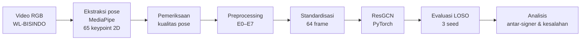

# Pengaruh Preprocessing Pose terhadap Generalisasi ResGCN pada WL-BISINDO

**Zidan Dwi Permana · Rekayasa Perangkat Lunak · Universitas Pendidikan Indonesia · 2026**

Penelitian skripsi tentang pengenalan kata Bahasa Isyarat Indonesia (BISINDO) dari video RGB berbasis **estimasi pose** dan **skeleton-based recognition**. Penelitian ini menguji pengaruh tiga teknik preprocessing pose, yaitu interpolasi, normalisasi spasial, dan augmentasi, terhadap akurasi dan konsistensi model ResGCN. Pengujian dilakukan pada orang yang datanya tidak dipakai saat pelatihan (*signer-independent*).

[Metode & cara menjalankan](docs/methods_and_reproduction.md) · [Hasil & keterbatasan](docs/evidence_and_limitations.md) · [Referensi](docs/references.md) · [Dataset](https://www.kaggle.com/datasets/glennleonali/wl-bisindo)

## Ringkasan

- **Pipeline lengkap dari video sampai evaluasi:** pembacaan frame (OpenCV), ekstraksi 65 keypoint 2D (MediaPipe), pemeriksaan kualitas pose, preprocessing, pelatihan ResGCN (PyTorch), dan analisis kesalahan.
- **Desain eksperimen faktorial 2³:** 8 konfigurasi × 4 fold Leave-One-Signer-Out (LOSO) × 3 seed = 96 proses pelatihan utama.
- **Hasil:** akurasi top-1 rata-rata naik dari **39,95%** (tanpa preprocessing) menjadi **74,53% ± 2,89** (ketiga teknik digabung). Normalisasi spasial memberikan pengaruh terbesar.
- **Keterbatasan:** hasil hanya berlaku untuk dataset dan protokol yang diuji; lihat [ruang lingkup](#ruang-lingkup).

## Alur penelitian

| Tahap | Pekerjaan |
|---|---|
| Ekstraksi pose | Membaca frame dengan OpenCV (BGR → RGB), lalu mengekstraksi landmark tubuh dan tangan dengan MediaPipe Pose Landmarker dan Hand Landmarker. |
| Pemeriksaan kualitas | Menganalisis panjang sekuens dan proporsi keypoint yang tidak terdeteksi per bagian tubuh dan per signer. |
| Preprocessing | Interpolasi linear untuk keypoint yang hilang, normalisasi posisi dan skala tubuh, augmentasi rotasi dan jitter pada data latih. |
| Model | ResGCN (`ResGCN_N39_R4`) dengan acuan arsitektur SIGNGRAPH; 460.276 parameter (dilaporkan di skripsi). |
| Evaluasi | Top-1 accuracy, precision, recall, F1, dan confusion matrix; perbandingan antar-signer dan antar-pengulangan. |

**Tools:** Python, PyTorch, OpenCV, MediaPipe Tasks, NumPy, SciPy, pandas, scikit-learn, Matplotlib.
**Lingkungan:** Google Colab dengan GPU NVIDIA Tesla T4, Google Drive untuk penyimpanan artefak.

## Rancangan eksperimen

| Komponen | Pengaturan |
|---|---|
| Dataset | WL-BISINDO: 1.600 video RGB, 32 kelas kata, 5 signer |
| Input model | 65 keypoint 2D, tensor `(2, 64, 65)` |
| Faktor | Interpolasi linear, normalisasi spasial, augmentasi (masing-masing aktif/nonaktif) |
| Konfigurasi | E0–E7 (semua kombinasi faktor) |
| Evaluasi | LOSO 4 fold: signer 1–4 bergantian menjadi data uji |
| Validasi internal | 15% dari kandidat data latih, distratifikasi berdasarkan label |
| Pengulangan | Seed 42, 123, 456 |

Catatan protokol:
- Signer uji tidak dipakai untuk pelatihan maupun validasi.
- Signer 0 tidak pernah menjadi data uji karena cakupan kelasnya tidak lengkap; datanya selalu masuk kelompok kandidat data latih.
- Semua konfigurasi memakai arsitektur, hyperparameter, dan standardisasi 64 frame yang sama. Augmentasi hanya diterapkan pada data latih.

## Hasil utama

| Konfigurasi | Interpolasi | Normalisasi | Augmentasi | Top-1 ± SD (%) | F1 tertimbang (%) |
|---|:---:|:---:|:---:|---:|---:|
| E0 | – | – | – | 39,95 ± 1,22 | 36,22 |
| E1 | ✓ | – | – | 43,61 ± 1,31 | 39,87 |
| E2 | – | ✓ | – | 66,29 ± 1,72 | 63,61 |
| E3 | – | – | ✓ | 43,28 ± 2,54 | 39,25 |
| E4 | ✓ | ✓ | – | 66,96 ± 4,00 | 63,52 |
| E5 | ✓ | – | ✓ | 49,55 ± 2,86 | 45,52 |
| E6 | – | ✓ | ✓ | 70,77 ± 1,67 | 68,12 |
| E7 | ✓ | ✓ | ✓ | **74,53 ± 2,89** | **72,68** |

Cara membaca tabel:
- Untuk setiap seed, skor adalah rata-rata empat fold LOSO dengan bobot sama per signer. Nilai pada tabel adalah rata-rata dan SD dari tiga skor seed tersebut.
- **SD = variasi antar-pengulangan**, bukan variasi antar-signer atau interval kepercayaan.
- Data lengkap: [`results/main_results.csv`](results/main_results.csv).

Temuan:
1. **E7 tertinggi**: naik 34,58 poin persentase dari E0. Pembandingnya adalah baseline internal dengan protokol yang sama, bukan hasil dari paper lain.
2. **Main effect normalisasi paling besar**: 25,54 poin persentase, diikuti augmentasi (5,33) dan interpolasi (3,59). Main effect tidak bisa dijumlahkan karena faktor-faktornya dapat berinteraksi. Data: [`results/main_effects.csv`](results/main_effects.csv).
3. **Akurasi tertinggi belum tentu paling konsisten**: SD E6 (1,67) lebih kecil daripada E7 (2,89), walaupun rata-rata E6 lebih rendah.

## Analisis antar-signer

| Signer uji | Top-1 E7 ± SD antar-seed (%) |
|---|---:|
| 1 | 86,27 ± 2,13 |
| 2 | 88,41 ± 2,08 |
| 3 | 47,60 ± 10,31 |
| 4 | 75,83 ± 2,08 |

Signer 3 jauh lebih sulit dan hasilnya paling tidak stabil. Jumlah keypoint yang hilang saja belum menjelaskan perbedaan ini. Penyebab pastinya **belum diketahui**: kualitas ekstraksi, karakteristik gerakan, dan representasi pose masih perlu diteliti. Data: [`results/e7_signer_results.csv`](results/e7_signer_results.csv).

## Ruang lingkup

| Dicakup penelitian ini | Belum dicakup / belum diuji |
|---|---|
| Ekstraksi pose 2D dari video RGB dengan model pralatih MediaPipe | Fusi RGB-D atau data kedalaman |
| Klasifikasi kata isyarat terisolasi berbasis sekuens pose | Isyarat kontinu (kalimat) |
| Evaluasi signer-independent pada 4 signer uji WL-BISINDO | Dataset lain, varian regional, kondisi kamera berbeda |
| Perbandingan preprocessing dengan desain faktorial | Uji signifikansi statistik dan set uji eksternal |
| Jumlah parameter model | Benchmark latensi, FPS, atau FLOPs |
| Notebook penelitian | Aplikasi atau prototipe real-time |

Detail keterbatasan: [hasil & keterbatasan](docs/evidence_and_limitations.md).

## Isi repository

| Berkas | Isi |
|---|---|
| [`notebooks/01_pose_extraction.ipynb`](notebooks/01_pose_extraction.ipynb) | Inventaris video, ekstraksi landmark, laporan kualitas pose |
| [`notebooks/02_resgcn_loso_e0_e7.ipynb`](notebooks/02_resgcn_loso_e0_e7.ipynb) | Preprocessing, pembagian LOSO, model, pelatihan, evaluasi |
| [`results/`](results/) | Rekap hasil E0–E7, main effect, dan hasil per signer |
| [`scripts/plot_reported_results.py`](scripts/plot_reported_results.py) | Pembuatan grafik dari CSV hasil |
| [`docs/`](docs/) | Metode, keterbatasan, referensi |

> [!IMPORTANT]
> Angka di repository ini adalah rekap dari skripsi. Video, cache pose, checkpoint, log per-run, dan catatan lingkungan asli **tidak disertakan**. Notebook sudah disesuaikan agar lokasi input/output bisa diatur, tetapi **pelatihan belum dijalankan ulang** dengan versi notebook ini. Lihat [catatan reproduksi](docs/methods_and_reproduction.md#ketersediaan-berkas).

## Referensi metode

- **Arsitektur:** SIGNGRAPH (Naz dkk., 2023), dengan landasan ResGCN (Song dkk., 2020) dan ST-GCN (Yan dkk., 2018). Implementasi ditulis ulang, tidak memakai source code asli SIGNGRAPH.
- **Preprocessing:** mempertimbangkan Roh dkk. (2024), Boháček & Hrúz (2022), De Coster dkk. (2020), Akdağ & Baykan (2024), Purbojo & Wijaya (2025), dan Jiang dkk. (2021). Implementasi utama hanya memakai interpolasi linear dan normalisasi pusat tubuh.

Daftar lengkap beserta peran setiap rujukan: [referensi](docs/references.md).

## Dataset dan atribusi

Dataset WL-BISINDO diperkenalkan oleh **Grace Oktaviani Kindy, Glenn Leonali, dan Henry Lucky** dalam *Word-Level BISINDO: A Novel Video Indonesian Sign Language Dataset and Baseline Methods*, Procedia Computer Science 269 (2025), 249–258. [DOI](https://doi.org/10.1016/j.procs.2025.08.277) · [Kaggle](https://www.kaggle.com/datasets/glennleonali/wl-bisindo)

Panduan kode asli dataset mencantumkan lisensi CC BY-NC 4.0; periksa ketentuan terbaru di sumber dataset. Video tidak didistribusikan ulang di sini. Penggunaan kode mengikuti [`LICENSE`](LICENSE).
